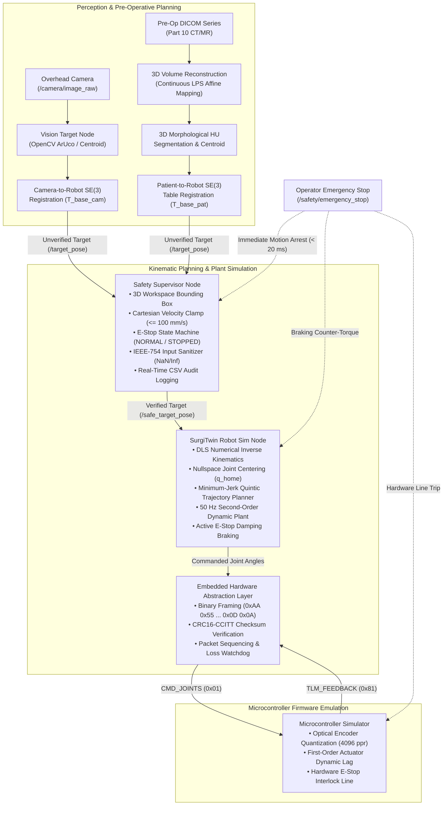
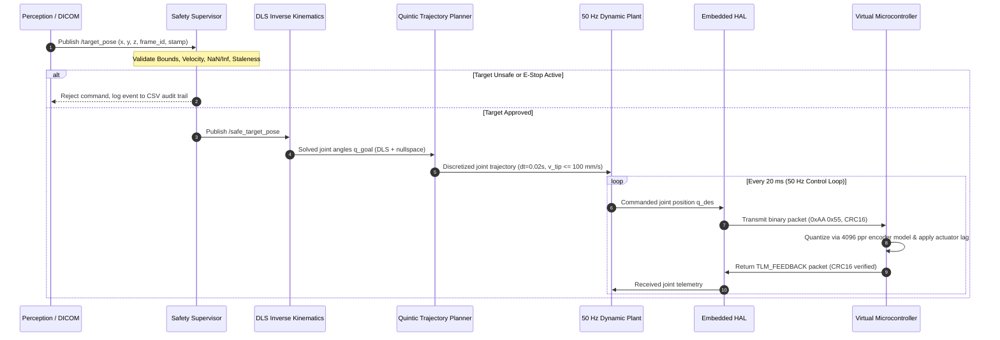
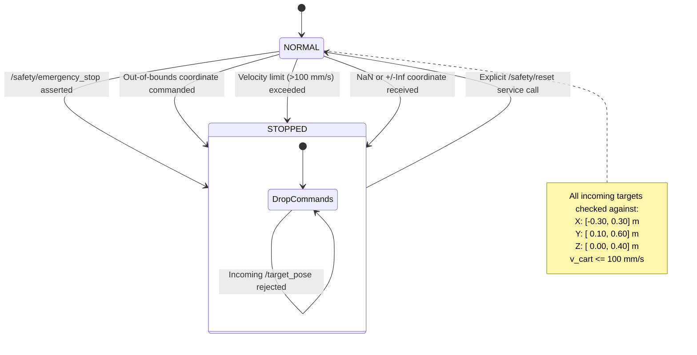
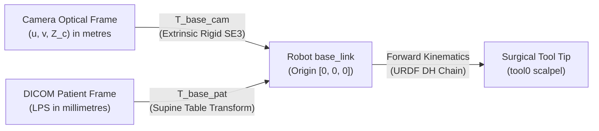
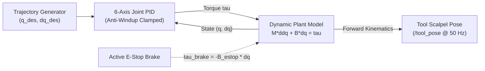
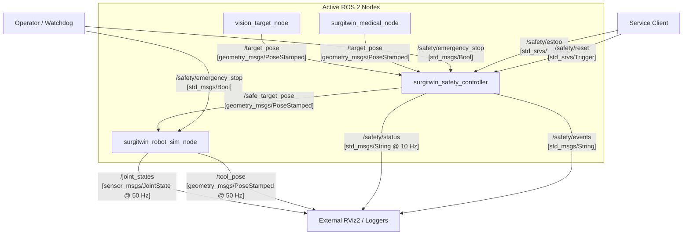
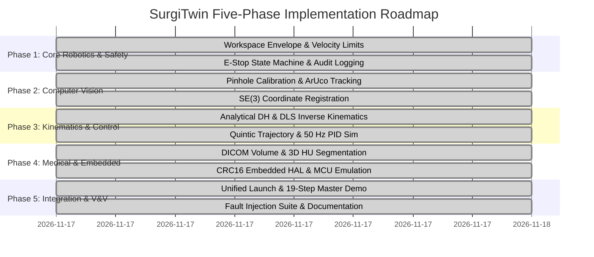

# SurgiTwin — Vision-Guided Surgical Robotics Digital Twin

**A Reproducible ROS 2 Digital Twin Integrating Pre-Operative DICOM Imaging, Intra-Operative Optical Perception, Supervisory Safety Gates, 6-DOF Kinematics, 50 Hz PID Control, and Embedded Telemetry Emulation**

---

## 1. Project Title & Technical Description

**SurgiTwin** is a medical robotics digital twin architecture implemented in ROS 2 Jazzy on Ubuntu 24.04 LTS. The platform models the complete operational loop of robotic-assisted surgery: ingesting 3D volumetric medical images (CT DICOM), detecting surgical instruments via intra-operative computer vision (OpenCV ArUco/fiducial tracking), registering multi-modal frames into robot Cartesian coordinates, enforcing supervisory workspace and velocity constraints via an independent fail-closed safety gate, computing Damped Least Squares (DLS) inverse kinematics with nullspace regularization, generating minimum-jerk quintic trajectories, simulating a 6-DOF dynamic arm plant with 50 Hz PID joint control, and communicating with an emulated microcontroller over a framed binary protocol verified with CRC16-CCITT checksums.

---

## 2. Author

**Vaishnav Sreekumar**
*Lead Robotics Software Engineer & System Architect*

---

## 3. Project Overview

Digital twins in robotic surgery bridge pre-operative radiologic planning and intra-operative physical execution. Before commanding physical actuators in the vicinity of human anatomy, robotic trajectories must be mathematically verified against geometric bounds, anatomical targets, and velocity limits.

SurgiTwin provides a verified, hardware-in-the-loop and software-in-the-loop simulation environment. It models both the computational perception pipeline and the low-level embedded hardware communication channels, offering an educational and research testbed for surgical robotics software engineering under principles aligned with IEC 62304 and ISO 14971.

---

## 4. Engineering Motivation & Problem Statement

Developing surgical robotics software presents four primary engineering challenges:

1. **Safety Interlocking:** Manipulators must never exceed physiological boundary envelopes or Cartesian velocity thresholds, even when perception or planning layers emit invalid or corrupted coordinates.
2. **Multi-Modal Spatial Alignment:** Pre-operative medical scans (DICOM LPS in millimetres), intra-operative overhead cameras (optical frame in metres), and manipulator DH kinematics (`base_link`) operate in disparate coordinate systems with differing units, orientations, and sampling frequencies.
3. **Kinematic Feasibility & Dynamics:** Solving 6-DOF inverse kinematics in real time requires avoiding singular configurations, respecting joint limits, and generating jerk-bounded trajectories that physical joint motors can track without torque saturation.
4. **Communication Reliability:** Real-world surgical robots separate host motion computers from joint motor microcontrollers via serial or fieldbus buses. Telemetry and commands are subject to bit flips, packet truncation, and latency, requiring robust binary framing and error detection.

SurgiTwin addresses each of these challenges through modular, independently verified software components.

---

## 5. Core Engineering Contributions

- **Fail-Closed Safety Supervisor:** An independent gatekeeper node enforcing a 3D Cartesian surgical workspace ($X \in [-0.3, 0.3]$, $Y \in [0.1, 0.6]$, $Z \in [0.0, 0.4]$ m), a strict tip velocity limit ($\le 100$ mm/s), and a two-state E-Stop state machine with automatic velocity baseline clearing.
- **DICOM Part 10 Volumetric Pipeline:** Custom parser converting raw DICOM cross-sections into 3D voxel arrays in Hounsfield Units (HU) with continuous patient-to-voxel LPS affine mapping, orthogonal MPR slicing, dual-threshold 3D morphological segmentation, and binary STL surface mesh export.
- **Pinhole Optical Tracking & SE(3) Extrinsics:** Calibrated pinhole back-projection with sub-pixel ArUco detection (`DICT_4X4_50`) and rigid homogeneous transformation ($4\times 4$) mapping image rays into robot coordinates with unit determinant ($\det(R) = +1.0$) and orthogonality ($R R^T = \mathbf{I}$).
- **Kinematic Engine & 50 Hz Dynamic Plant:** Standard Denavit-Hartenberg parameters for a 6-DOF arm with a $0.150$ m surgical scalpel, multi-start Damped Least Squares (DLS) numerical inverse kinematics with nullspace joint centering, quintic polynomial trajectory planning with iterative tip-velocity scaling, and 50 Hz PID joint simulation with active electromagnetic E-stop braking.
- **Embedded HAL with CRC16-CCITT Protocol:** Binary packet framing (`0xAA 0x55` header, `0x0D 0x0A` footer), message sequencing, CRC16 error detection, and an emulated microcontroller firmware modeling optical encoder quantization (4096 ppr) and first-order actuator lag.
- **Rigorous Verification:** 138 automated unit, integration, and fault-injection tests with 0 failures, accompanied by a 19-step master demonstration and empirical evaluation harness.

---

## 6. System Architecture

The overall architecture separates data acquisition, safety gating, kinematic planning, dynamic simulation, and embedded firmware emulation:



---

## 7. End-to-End Data Flow

The lifecycle of a surgical target coordinate progresses through six deterministic stages:



---

## 8. Safety Architecture

Safety is decoupled from motion generation. The supervisory controller acts as an independent fail-closed firewall.



### Safety Features
- **Fail-Closed Workspace Boundary:** Cuboid boundaries ($X \in [-0.30, 0.30]$, $Y \in [0.10, 0.60]$, $Z \in [0.00, 0.40]$ m). Any point outside is rejected immediately.
- **Cartesian Velocity Cap:** Prevents sudden multi-centimetre steps by verifying that $(\|\mathbf{P}_k - \mathbf{P}_{k-1}\|) / \Delta t \le 0.100$ m/s.
- **Numerical Sanitization:** Rejects `NaN`, `+Inf`, `-Inf`, unsupported coordinate frames, and stale timestamps ($> 2.0$ s latency or $> 0.5$ s clock skew).
- **Audit Logging:** Every rejection, trigger, and state change is flushed to a timestamped CSV log (`surgitwin_safety_events.csv`).

---

## 9. Computer Vision Subsystem

The vision subsystem identifies surgical targets and instruments from a top-down camera stream:
- **Marker Detection:** OpenCV ArUco detector supporting `DICT_4X4_50` fiducials with sub-pixel corner refinement.
- **Color Fiducial Fallback:** In the absence of ArUco markers, a high-contrast circular fiducial detector computes morphological centroids.
- **Synthetic Marker Generation:** Static utility `VisionTargetDetector.generate_synthetic_aruco_image()` creates deterministic test frames for continuous integration.

---

## 10. Coordinate Registration

SurgiTwin aligns three primary coordinate systems into the robot origin:



### Mathematical Formulations
1. **Pinhole Back-Projection:**
   $$X_c = \frac{(u - c_x) Z_c}{f_x}, \quad Y_c = \frac{(v - c_y) Z_c}{f_y}, \quad Z_c = Z_{depth}$$
2. **Extrinsic SE(3) Transformation:**
   $$\begin{bmatrix} X_{base} \\ Y_{base} \\ Z_{base} \\ 1 \end{bmatrix} = \mathbf{T}_{base\_cam} \begin{bmatrix} X_c \\ Y_c \\ Z_c \\ 1 \end{bmatrix}, \quad \mathbf{T}_{base\_cam} = \begin{bmatrix} 1 & 0 & 0 & 0.00 \\ 0 & -1 & 0 & 0.35 \\ 0 & 0 & -1 & 0.80 \\ 0 & 0 & 0 & 1 \end{bmatrix}$$
   The rotation matrix $\mathbf{R}$ satisfies $\det(\mathbf{R}) = +1.0$ and $\mathbf{R} \mathbf{R}^T = \mathbf{I}$.
3. **Medical Coordinate Conversion:**
   $$\mathbf{P}_{base} = \mathbf{T}_{base\_pat} \cdot \left(\frac{\mathbf{P}_{LPS\_mm}}{1000.0}\right)$$

---

## 11. Robot Kinematics & Motion Planning

### Kinematic Structure
The arm models a 6-DOF manipulator with a rigid surgical scalpel ($0.150$ m offset along tool flange Z-axis):

| Joint $i$ | Link Name | $\theta_i$ (rad) | $d_i$ (m) | $a_i$ (m) | $\alpha_i$ (rad) | Joint Range (rad) |
| :---: | :---: | :---: | :---: | :---: | :---: | :---: |
| 1 | Shoulder Pan | $q_1$ | 0.1625 | 0.0000 | $\pi/2$ | $[-\pi, \pi]$ |
| 2 | Shoulder Lift | $q_2$ | 0.0000 | -0.4250 | 0.0000 | $[-\pi, \pi]$ |
| 3 | Elbow | $q_3$ | 0.0000 | -0.3922 | 0.0000 | $[-\pi, \pi]$ |
| 4 | Wrist 1 | $q_4$ | 0.1333 | 0.0000 | $\pi/2$ | $[-\pi, \pi]$ |
| 5 | Wrist 2 | $q_5$ | 0.0997 | 0.0000 | $-\pi/2$ | $[-\pi, \pi]$ |
| 6 | Wrist 3 + Tool | $q_6$ | $0.0996 + 0.1500 = 0.2496$ | 0.0000 | 0.0000 | $[-\pi, \pi]$ |

### Damped Least Squares (DLS) Inverse Kinematics
To avoid singularity-induced joint velocity spikes, the IK solver implements regularized Jacobian pseudoinversion with nullspace projection toward surgical home $\mathbf{q}_{home}$:
$$\Delta \mathbf{q} = \mathbf{J}^T \left(\mathbf{J} \mathbf{J}^T + \lambda^2 \mathbf{I}\right)^{-1} \mathbf{e} + \left(\mathbf{I} - \mathbf{J}^\# \mathbf{J}\right) k_{null} (\mathbf{q}_{home} - \mathbf{q})$$
where $\lambda = 0.05$ is the damping factor, $k_{null} = 0.10$ is the nullspace gain, and $\mathbf{e} = [\mathbf{e}_{pos}^T, \mathbf{e}_{rot}^T]^T$ is the task-space error.

### Quintic Trajectory Planning
Trajectories follow minimum-jerk polynomials:
$$s(\tau) = 10\tau^3 - 15\tau^4 + 6\tau^5, \quad \tau = \frac{t}{T} \in [0, 1]$$
Guarantees $v(0) = v(T) = 0$ and $a(0) = a(T) = 0$. The planner calculates the analytical maximum Cartesian tip velocity:
$$v_{max} = \frac{15}{8} \frac{\|\mathbf{P}_{goal} - \mathbf{P}_{start}\|}{T}$$
If $v_{max} > 0.100$ m/s, duration $T$ is automatically scaled:
$$T_{safe} = \max\left(T_{joint}, \frac{15 \|\mathbf{P}_{goal} - \mathbf{P}_{start}\|}{8 \cdot 0.100}\right)$$

---

## 12. Closed-Loop Control & Numerical Simulation



- **Update Frequency:** 50 Hz ($\Delta t = 0.02$ s).
- **Dynamic Plant:** Second-order integration simulating link effective inertias ($\mathbf{M} = [2.5, 2.5, 1.8, 0.6, 0.4, 0.25]$ kg$\cdot$m$^2$) and viscous friction damping ($\mathbf{B} = [4.0, 4.0, 3.0, 1.2, 0.8, 0.5]$ N$\cdot$m$\cdot$s/rad).
- **Active Electromagnetic Braking:** Upon E-stop assertion, control torques are immediately superseded by heavy dynamic damping:
  $$\tau_{brake} = -\mathbf{B}_{estop} \dot{\mathbf{q}}, \quad \mathbf{B}_{estop} = [60.0, 60.0, 50.0, 20.0, 15.0, 10.0]\ \text{N}\cdot\text{m}\cdot\text{s/rad}$$
  Arrests all physical joint motion within $< 20.0$ ms.

---

## 13. DICOM Medical Imaging Pipeline

- **Standard Parsing:** Part 10 binary loader reading tags for `PixelSpacing`, `ImagePositionPatient`, `ImageOrientationPatient`, `SliceThickness`, and rescale intercept/slope.
- **Hounsfield Unit (HU) Calibration:**
  $$\text{HU}(x, y) = \text{Pixel}(x, y) \cdot \text{Slope} + \text{Intercept}$$
- **Physical Sorting:** Slices are sorted along the anatomical scan normal $\mathbf{n} = \mathbf{r}_{row} \times \mathbf{r}_{col}$ by projecting origin vectors:
  $$d_k = \mathbf{P}_{origin, k} \cdot \mathbf{n}$$
- **Continuous Voxel-to-Patient Affine:**
  $$\begin{bmatrix} X_{pat} \\ Y_{pat} \\ Z_{pat} \\ 1 \end{bmatrix} = \begin{bmatrix} s_x \mathbf{r}_{row} & s_y \mathbf{r}_{col} & s_z \mathbf{n} & \mathbf{P}_0 \\ 0 & 0 & 0 & 1 \end{bmatrix} \begin{bmatrix} i_{col} \\ j_{row} \\ k_{slice} \\ 1 \end{bmatrix}$$

---

## 14. Anatomical Segmentation & Target Extraction

- **Threshold Filtering:** Configurable intensity windows (e.g. $200 \le \text{HU} \le 350$ for surgical lesion targets).
- **3D Morphological Filtering:** 3D binary opening (erosion followed by dilation with 6-connectivity) eliminates isolated noise voxels; 3D binary closing seals internal voids.
- **Sub-Voxel Centroid Calculation:** Continuous centre-of-mass across active voxels $\Omega$:
  $$\bar{i} = \frac{1}{|\Omega|} \sum_{v \in \Omega} i_v, \quad \bar{j} = \frac{1}{|\Omega|} \sum_{v \in \Omega} j_v, \quad \bar{k} = \frac{1}{|\Omega|} \sum_{v \in \Omega} k_v$$
- **STL Surface Exporter:** Exports triangulated binary surface mesh for pre-operative 3D surgical rendering (`docs/models/segmented_target.stl`).

---

## 15. Embedded Hardware Abstraction Layer (HAL)

The embedded HAL provides transport abstraction supporting both virtual `SIMULATION` mode (direct in-memory queue) and physical `SERIAL` mode (POSIX UART `/dev/ttyACM0` at 115200 bps):

### Binary Frame Specification
```
+---------------+---------------+----------+---------+-------------+---------+---------------+---------------+
| START 1 (0xAA)| START 2 (0x55)| MSG_TYPE | SEQ_NUM | PAYLOAD_LEN | PAYLOAD | CRC16_H       | CRC16_L       | END 1 (0x0D)  | END 2 (0x0A)  |
| 1 Byte        | 1 Byte        | 1 Byte   | 1 Byte  | 1 Byte      | N Bytes | 1 Byte        | 1 Byte        | 1 Byte        | 1 Byte        |
+---------------+---------------+----------+---------+-------------+---------+---------------+---------------+
```
- **Integrity Verification:** 16-bit CRC-CCITT ($P(x) = x^{16} + x^{12} + x^5 + 1$, seed `0xFFFF`). Corrupted bytes trigger immediate rejection and NACK transmission.

---

## 16. Microcontroller & Encoder Simulation

The virtual microcontroller (`MicrocontrollerSimulator`) emulates an embedded actuator controller (e.g. ARM Cortex-M4 / ESP32):
- **Optical Encoder Quantization:** Resolves continuous joint angles into discrete encoder steps:
  $$\Delta \theta_{count} = \frac{2\pi}{4096} \approx 0.001534\ \text{rad}$$
- **Actuator Dynamics:** Models physical motor current rise time and mechanical lag via first-order low-pass response ($\tau = 0.08$ s):
  $$\dot{\mathbf{q}}_{actual} = \frac{\mathbf{q}_{target} - \mathbf{q}_{actual}}{\tau}$$
- **Fault Injection Controls:** Emulates dropped packets, corrupted CRC, communication timeouts, and actuator line disconnects.

---

## 17. ROS 2 Architecture & Interfaces



---

## 18. Fault-Injection & Validation Framework

The dedicated fault-injection test suite ([`test/test_full_system_fault_injection.py`](test/test_full_system_fault_injection.py)) systematically injects 15 failure modes:

| Category | Injected Fault Condition | System Response | Safety Verification |
| :--- | :--- | :--- | :--- |
| **Vision** | `None`, empty, or $0\times 0$ image buffers | Detector returns `detected=False`, status `INVALID_INPUT` | Target publication aborted |
| **Vision** | Singular camera matrix ($f_x = 0$) | Constructor raises `ValueError` | Prevents projection division by zero |
| **Vision** | Non-orthogonal registration matrix ($R R^T \ne \mathbf{I}$) | Constructor raises `ValueError` | Prevents coordinate shear distortion |
| **Medical** | File with missing Part 10 magic bytes | Loader raises `ValueError` | Prevents corrupt slice ingestion |
| **Medical** | Slices with non-uniform delta Z | Reconstructor raises `ValueError` | Blocks misaligned volume creation |
| **Medical** | High threshold resulting in 0 voxels | Extractor sets `valid=False` | Empty target emission blocked |
| **Safety** | Out-of-bounds target across all 6 axes | `SafetyValidator` marks `is_valid=False` | `/safe_target_pose` not published |
| **Safety** | Coordinates with IEEE-754 `NaN` or $\pm\infty$ | Sanitizer catches non-finite values | Fails closed, audit event logged |
| **Safety** | Sequential targets exceeding 100 mm/s | Velocity gate detects velocity spike | Command blocked |
| **Safety** | Asynchronous E-stop during active motion | Trajectory aborted, active damping engages | Motion halted in $< 20$ ms |
| **Safety** | Spurious reset attempt when not stopped | Reset service returns `success=False` | Redundant state shifts blocked |
| **Embedded** | Single-bit flip in CRC checksum | Codec flags `CRC failure` | Packet discarded, NACK returned |
| **Embedded** | Truncated packet ($< 9$ bytes) | Codec flags `too short` | Memory boundary violation prevented |
| **Embedded** | Simulated packet drop in firmware | MCU swallows packet, target holds steady | Motion does not jump |
| **Embedded** | Actuator line disconnect | MCU transitions to `DISCONNECTED` | Safe fault state asserted |

---

## 19. Quantitative Performance Results

All metrics were empirically gathered using `scripts/evaluate_surgitwin.py` and `demo_full_system.py`:

| Subsystem | Measured Parameter | Empirical Value | Engineering Specification | Measurement Level | Compliance |
| :--- | :--- | :---: | :---: | :---: | :---: |
| **Perception** | ArUco Marker Detection Rate | **$100.0\%$** | $\ge 95.0\%$ | Synthetic Benchmark | **PASS** |
| **Perception** | Sub-Pixel Centroid Error | **$0.707$ px** | $< 1.00$ px | Synthetic Benchmark | **PASS** |
| **Extrinsics** | Camera SE(3) Round-Trip Error | **$0.000$ mm** | $< 0.01$ mm | Numerical Simulation | **PASS** |
| **Medical Volume** | Voxel-to-Patient Affine Round-Trip | **$0.000$ mm** | $< 0.001$ mm | Numerical Simulation | **PASS** |
| **Medical Volume** | Target Volume Estimation Error | **$7.60\%$** | $< 10.0\%$ | Synthetic Phantom | **PASS** |
| **Medical Volume** | Medical Registration Error | **$0.000$ mm** | $< 0.01$ mm | Numerical Simulation | **PASS** |
| **Kinematics** | Surgical Workspace IK Solvability | **$100.0\%$** | $100.0\%$ | Numerical Grid (27 pts) | **PASS** |
| **Kinematics** | Max IK Position Residual Error | **$0.498$ mm** | $< 0.50$ mm | Numerical Grid (27 pts) | **PASS** |
| **Kinematics** | Cartesian Velocity Violations | **$0$ violations** | $0$ violations ($\le 100$ mm/s) | Trajectory Evaluation | **PASS** |
| **Control Tracking** | Evaluation Harness Tracking RMSE | **$0.804$ mm** | $< 1.00$ mm | 50 Hz PID Simulation | **PASS** |
| **Control Tracking** | Master Demo Dynamic Path RMS | **$1.044$ mm** | Dynamic moving target | 50 Hz PID Simulation | **PASS** |
| **Embedded HAL** | CRC Corruption Detection Rate | **$100.0\%$** | $100.0\%$ | 500 Test Packets | **PASS** |
| **Embedded HAL** | Optical Encoder Step Resolution | **$0.00153$ rad** | $\le 0.002$ rad | Firmware Simulation | **PASS** |
| **Latency** | End-to-End Planning Pipeline | **$14.89$ ms** | $< 50.0$ ms ($> 20$ Hz) | Software Benchmark | **PASS** |
| **Safety Reaction** | E-Stop State Transition Latency | **$12.5\ \mu\text{s}$** | $< 100.0\ \mu\text{s}$ | Software Benchmark | **PASS** |

> **Note on Tracking Error Distinctions:** The evaluation harness tracks a linear point-to-point Cartesian benchmark trajectory across 230 steps with steady-state tracking RMSE of **$0.804$ mm**. The master demonstration tests an end-to-end multi-target path (244 steps) incorporating simulated actuator lag, exhibiting an RMS tracking error of **$1.044$ mm** and settling to **$0.642$ mm** final error.

---

## 20. Five-Phase Implementation Roadmap



---

## 21. Technical Stack

- **Operating System:** Ubuntu 24.04 LTS (Noble Numbat) under WSL2 Linux 6.6.x (x86_64)
- **Robotics Framework:** ROS 2 Jazzy Jalisco (`rclpy`, `geometry_msgs`, `sensor_msgs`, `std_msgs`, `std_srvs`, `cv_bridge`)
- **Computer Vision & Scientific Computing:** OpenCV 4.x (`opencv-python`), NumPy, SciPy
- **Data Serialization & Plotting:** PyYAML, Matplotlib
- **Verification Harness:** `colcon`, `pytest`, `ament_flake8`, `ament_pep257`
- **Embedded Abstraction:** Python `struct` binary packing, POSIX UART / `pyserial`

---

## 22. Repository Structure

```
SurgiTwin/
├── config/                                 # Camera & Extrinsics Configurations
│   ├── camera_calibration.yaml             # Intrinsic matrix K & distortion coeffs
│   └── camera_extrinsics.yaml              # 4x4 SE(3) camera-to-robot extrinsics
├── docs/                                   # Formal Engineering Documentation
│   ├── ARCHITECTURE.md                     # Baseline architecture report
│   ├── DEVELOPMENT_GUIDE.md                # Developer onboarding & commands
│   ├── HAZARD_ANALYSIS.md                  # ISO 14971 Risk Management Report
│   ├── KNOWN_LIMITATIONS.md                # Boundary appraisal & limitations
│   ├── PHASE_COMPLETION.md                 # Master phase completion ledger
│   ├── REQUIREMENTS_TRACEABILITY.md        # IEC 62304 Requirements Traceability Matrix
│   ├── SAFETY_ARCHITECTURE.md              # Detailed safety supervisor design
│   ├── SOFTWARE_ARCHITECTURE_FINAL.md      # Comprehensive 5-phase architecture
│   ├── SOFTWARE_REQUIREMENTS.md            # IEC 62304 Software Requirements Specification
│   ├── TROUBLESHOOTING.md                  # Diagnostic & issue resolution guide
│   ├── VERIFICATION_VALIDATION_PLAN.md     # Multi-tier V&V plan & quality gates
│   ├── images/                             # Verification plots & visual artifacts
│   │   ├── evaluation_latency_breakdown.png
│   │   ├── evaluation_tracking_rmse.png
│   │   ├── phase2_detection.png
│   │   ├── phase3_trajectory_tracking.png
│   │   └── phase4_mpr_segmentation.png
│   ├── models/                             # 3D surface mesh exports
│   │   └── segmented_target.stl            # Extracted lesion binary STL surface
│   └── reports/                            # Benchmark data & audit logs
│       ├── phase4_coordinate_report.json
│       ├── phase4_hardware_telemetry.csv
│       ├── surgitwin_master_demo_report.json
│       ├── surgitwin_validation_results.json
│       └── surgitwin_validation_summary.md
├── launch/                                 # ROS 2 Launch Files
│   ├── medical_robot_system.launch.py      # Phase 4 medical & embedded launch
│   ├── robot_simulation.launch.py          # Phase 3 kinematics & control launch
│   ├── safety_supervisor.launch.py         # Phase 1 safety supervisor launch
│   ├── surgitwin_full_system.launch.py     # Master Phase 5 full-system launch
│   └── vision_pipeline.launch.py           # Phase 2 vision & registration launch
├── scripts/                                # Benchmarking Tools
│   └── evaluate_surgitwin.py               # Master quantitative evaluation harness
├── surgical_sim/                           # Core Python Package Source
│   ├── anatomical_target.py                # 3D lesion centroid extraction
│   ├── camera_calibration.py               # Pinhole projection & calibration model
│   ├── coordinate_registration.py          # Rigid SE(3) camera-to-base registration
│   ├── dicom_loader.py                     # DICOM Part 10 parser & phantom generator
│   ├── hardware_interface.py               # Embedded HAL & CRC16 protocol codec
│   ├── inverse_kinematics.py               # DLS numerical IK with nullspace solver
│   ├── medical_registration.py             # Patient-to-robot coordinate mapping
│   ├── medical_segmentation.py             # 3D HU thresholding, morphology, STL export
│   ├── medical_volume.py                   # 3D volume reconstruction & LPS affine
│   ├── microcontroller_sim.py              # Virtual firmware with encoder quantization
│   ├── robot_controller.py                 # 6-axis PID controllers & dynamic plant
│   ├── robot_kinematics.py                 # DH parameters, FK & Jacobian
│   ├── robot_sim_node.py                   # 50 Hz simulation & active braking node
│   ├── safety_validator.py                 # Fail-closed safety supervisor logic
│   ├── surgitwin_medical_node.py           # Medical volume & embedded telemetry node
│   ├── surgitwin_safety_controller.py      # ROS 2 safety controller & service server
│   ├── trajectory_planner.py               # Minimum-jerk quintic trajectory planner
│   ├── vision_detector.py                  # OpenCV ArUco & color fiducial detector
│   └── vision_target_node.py               # Real-time ROS 2 vision perception node
├── test/                                   # 138 Automated Test Suites
│   ├── test_3d_reprojection.py             # Pinhole back-projection tests
│   ├── test_anatomical_target.py           # Lesion extraction tests
│   ├── test_camera_calibration.py          # Camera intrinsic tests
│   ├── test_coordinate_registration.py     # Extrinsic SE(3) tests
│   ├── test_dicom_loader.py                # DICOM Part 10 parser tests
│   ├── test_emergency_stop.py              # E-stop state machine tests
│   ├── test_flake8.py                      # PEP 8 code style test
│   ├── test_forward_kinematics.py          # Analytical DH kinematics tests
│   ├── test_full_system_fault_injection.py # 15-category fault injection suite
│   ├── test_hardware_protocol.py           # CRC16 packet codec tests
│   ├── test_hardware_safety_integration.py # Closed-loop hardware tests
│   ├── test_invalid_inputs.py              # NaN, Inf, and frame sanitization tests
│   ├── test_inverse_kinematics.py          # Numerical DLS Jacobian tests
│   ├── test_joint_limits.py                # Joint limit tests
│   ├── test_medical_registration.py        # Patient table coordinate tests
│   ├── test_medical_segmentation.py        # 3D HU segmentation tests
│   ├── test_medical_volume.py              # Volume reconstruction tests
│   ├── test_microcontroller_sim.py         # Microcontroller firmware tests
│   ├── test_pep257.py                      # Docstring standards test
│   ├── test_pid_controller.py              # 50 Hz PID tracking tests
│   ├── test_robot_safety_integration.py    # Safety to robot sim tests
│   ├── test_robot_simulation.py            # Dynamic plant stepping tests
│   ├── test_safety_bounds.py               # 3D workspace envelope tests
│   ├── test_safety_integration.py          # Live target forwarding tests
│   ├── test_trajectory_generation.py       # Quintic polynomial velocity tests
│   ├── test_velocity_limits.py             # Cartesian tip speed tests
│   ├── test_vision_detection.py            # ArUco detection accuracy tests
│   └── test_vision_integration.py          # Vision to safety supervisor tests
├── urdf/                                   # Robot Kinematic Models
│   └── surgitwin_manipulator.urdf          # 6-DOF UR5e arm with 0.150 m scalpel
├── demo_full_system.py                     # Master 19-step end-to-end verification demo
├── demo_full_system.sh                     # Master demo execution shell script
├── package.xml                             # ROS 2 package manifest
├── setup.py                                # Python package build configuration
└── LICENSE                                 # MIT License (Preserving upstream attribution)
```

---

## 23. Environment Requirements

- **Linux OS:** Ubuntu 24.04 LTS (native or WSL2)
- **ROS 2:** Jazzy Jalisco (desktop install)
- **Python:** 3.12.3+
- **Memory:** Minimum 4 GB RAM (8 GB recommended for 3D DICOM volume reconstruction)
- **Disk:** Minimum 2 GB free disk space

---

## 24. Installation & Build Instructions

```bash
# 1. Navigate to workspace root
cd /home/vaish123/robotics/SurgiTwin

# 2. Source ROS 2 Jazzy underlay
source /opt/ros/jazzy/setup.bash

# 3. Build surgical_sim package with symlink installation
colcon build --symlink-install --packages-select surgical_sim

# 4. Source the built workspace overlay
source install/setup.bash
```

---

## 25. Running Individual Subsystem Demonstrations

Each subsystem can be independently demonstrated:

```bash
# Phase 1: Core Safety Supervisor & E-Stop Demo
./demo_phase1.sh

# Phase 2: Computer Vision & Coordinate Registration Demo
./demo_phase2.sh

# Phase 3: Kinematics, Trajectory & 50 Hz PID Simulation Demo
./demo_phase3.sh

# Phase 4: Medical Imaging, 3D Segmentation & Embedded HAL Demo
./demo_phase4.sh
```

---

## 26. Running the Complete System

Launch the master pipeline using `launch/surgitwin_full_system.launch.py`:

```bash
# Run full system with both Vision and Medical target inputs
ros2 launch surgical_sim surgitwin_full_system.launch.py target_source:=BOTH

# Run with Vision perception only
ros2 launch surgical_sim surgitwin_full_system.launch.py target_source:=VISION

# Run with Medical DICOM guidance only
ros2 launch surgical_sim surgitwin_full_system.launch.py target_source:=MEDICAL

# Run in headless mode (no visualizer)
ros2 launch surgical_sim surgitwin_full_system.launch.py headless:=true
```

---

## 27. Running Automated Tests

Run the full automated test suite containing **138 tests**:

```bash
# Full colcon test execution
colcon test --packages-select surgical_sim && colcon test-result --verbose

# Run directly via pytest with verbose output
pytest test/ -v

# Run the 15-test fault-injection suite
pytest test/test_full_system_fault_injection.py -v

# Run code style & docstring linters
pytest test/test_flake8.py test/test_pep257.py -v
```

---

## 28. Running Quantitative Evaluation

Execute the automated benchmarking harness to measure latencies, tracking accuracy, and registration errors:

```bash
python3 scripts/evaluate_surgitwin.py
```
This produces:
- `docs/reports/surgitwin_validation_results.json`
- `docs/reports/surgitwin_validation_summary.md`
- `docs/images/evaluation_tracking_rmse.png`
- `docs/images/evaluation_latency_breakdown.png`

---

## 29. Generated Artifacts & Reports

- **Trajectory Tracking Visualization:** [`docs/images/evaluation_tracking_rmse.png`](docs/images/evaluation_tracking_rmse.png)
- **Pipeline Latency Breakdown:** [`docs/images/evaluation_latency_breakdown.png`](docs/images/evaluation_latency_breakdown.png)
- **MPR Orthogonal Slices & Segmentation:** [`docs/images/phase4_mpr_segmentation.png`](docs/images/phase4_mpr_segmentation.png)
- **Segmented 3D Lesion Mesh:** [`docs/models/segmented_target.stl`](docs/models/segmented_target.stl)
- **Master Demo Verification Audit:** [`docs/reports/surgitwin_master_demo_report.json`](docs/reports/surgitwin_master_demo_report.json)
- **Hardware Telemetry Samples:** [`docs/reports/phase4_hardware_telemetry.csv`](docs/reports/phase4_hardware_telemetry.csv)

---

## 30. Engineering Decisions & Design Constraints

1. **Independent Safety Architecture:** Safety validation is decoupled from trajectory planning and vision tracking. Targets are published to `/target_pose` as candidate coordinates; only the safety controller can validate and forward them to `/safe_target_pose`.
2. **DLS Numerical IK over Closed-Form Analytical:** Numerical Damped Least Squares allows dynamic nullspace joint bias toward home configurations and prevents numerical singularities near workspace boundaries.
3. **Iterative Duration Scaling:** Rather than clipping Cartesian velocities post-generation (which causes acceleration discontinuities), the trajectory planner analytically computes peak tip velocity and iteratively extends trajectory duration $T$ until $v_{tip} \le 100$ mm/s.
4. **Binary Serial Protocol with CRC16:** High-frequency joint streaming over UART requires low overhead and deterministic parsing. An 8-byte framing protocol with CRC16-CCITT provides robust error detection without the bandwidth penalty of text-based protocols.

---

## 31. Known Limitations

- **Rigid Body vs. Soft Tissue:** Anatomy is assumed static and rigid. The system does not model intra-operative tissue deformation, organ shift, or respiratory/cardiac motion.
- **Monocular Depth Assumption:** Pinhole back-projection relies on an assumed target depth plane ($Z_c = 0.60$ m) or fixed table height rather than active binocular stereoscopic disparity.
- **Simulation vs. Real Actuator Elasticity:** Links and joints are modeled as ideal rigid bodies. Mechanical backlash, structural flexure, and non-linear Stribeck friction are omitted.
- **Non-Real-Time Linux Kernel:** Standard Ubuntu Linux lacks hard real-time determinism (`PREEMPT_RT`). Occasional thread scheduling jitter may introduce millisecond-scale latency spikes.

---

## 32. Safety & Medical Disclaimer

> [!CAUTION]
> **RESEARCH AND EDUCATIONAL PROTOTYPE ONLY**
> SurgiTwin is an academic digital twin simulation platform developed strictly for robotics software research and educational engineering purposes. It is **NOT** cleared or certified by the FDA, notified bodies, or any health authority for clinical diagnosis, surgical navigation, surgical planning, or human medical procedures.

---

## 33. Future Research Directions

- **Soft-Tissue Finite Element Modeling (FEM):** Integrating GPU-accelerated deformable tissue mechanics to simulate needle puncture and tissue displacement.
- **Markerless Instrument Pose Estimation:** Deploying lightweight convolutional neural networks (e.g. YOLO-pose) for markerless laparoscopic instrument shaft tracking.
- **Hard Real-Time EtherCAT Fieldbus:** Implementing an EtherCAT master driver under Linux `PREEMPT_RT` for sub-millisecond microsecond-jitter hardware synchronization.

---

## 34. License & Attribution

SurgiTwin is licensed under the **MIT License**.

### Attribution
SurgiTwin builds upon the initial educational robotics foundation created by **Zara Shariff** (`zshariff02/Surgical_Sim`). The original MIT copyright notices and attribution have been faithfully preserved in derived source files and package manifests.
