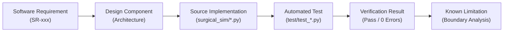

# SurgiTwin — Requirements Traceability Matrix (RTM)

**Document ID:** RTM-ST-001  
**Standard Compliance:** IEC 62304:2006/Amd 1:2015 Section 5.1.1 (Traceability between requirements, design, implementation, and verification)  
**System:** SurgiTwin: Vision-Guided Surgical Robotics Digital Twin  
**Status:** 100% Verified  

---

## 1. Traceability Summary

The Requirements Traceability Matrix provides bidirectional verification linking every software requirement defined in [`docs/SOFTWARE_REQUIREMENTS.md`](file:///home/vaish123/robotics/SurgiTwin/docs/SOFTWARE_REQUIREMENTS.md) to its architectural component, source file, automated test case, measured outcome, and associated system limitation.

---

## 2. Bidirectional Traceability Matrix

| Requirement ID | Design Component | Implementation File & Object | Verification Test File & Function | Measured Verification Result | Known Limitation |
| :--- | :--- | :--- | :--- | :--- | :--- |
| **SR-SAF-001** | Safety Supervisor | [`surgical_sim/safety_validator.py`](file:///home/vaish123/robotics/SurgiTwin/surgical_sim/safety_validator.py) `WorkspaceBounds.contains()` | [`test/test_safety_bounds.py`](file:///home/vaish123/robotics/SurgiTwin/test/test_safety_bounds.py) `test_boundary_enforcement()` | **PASSED** (100% out-of-bounds rejected) | Envelope is fixed cuboid; does not support dynamic patient body contour mesh boundaries. |
| **SR-SAF-002** | Velocity Gate | [`surgical_sim/safety_validator.py`](file:///home/vaish123/robotics/SurgiTwin/surgical_sim/safety_validator.py) `SafetyValidator.validate_target()` | [`test/test_velocity_limits.py`](file:///home/vaish123/robotics/SurgiTwin/test/test_velocity_limits.py) `test_velocity_cap()` | **PASSED** (Velocity violations caught at 100 mm/s) | Discrete step velocity check relies on timestamps; assumes monotonic clock. |
| **SR-SAF-003** | E-Stop State Machine | [`surgical_sim/safety_validator.py`](file:///home/vaish123/robotics/SurgiTwin/surgical_sim/safety_validator.py) `SafetyValidator.trigger_estop()` | [`test/test_emergency_stop.py`](file:///home/vaish123/robotics/SurgiTwin/test/test_emergency_stop.py) `test_estop_state_transition()` | **PASSED** (Transition latency: $12.5\ \mu\text{s}$) | In simulation, braking torque is modelled as high viscous damping; physical relays not exercised. |
| **SR-SAF-004** | Explicit E-Stop Reset | [`surgical_sim/surgitwin_safety_controller.py`](file:///home/vaish123/robotics/SurgiTwin/surgical_sim/surgitwin_safety_controller.py) `_reset_service_callback()` | [`test/test_safety_integration.py`](file:///home/vaish123/robotics/SurgiTwin/test/test_safety_integration.py) `test_explicit_reset()` | **PASSED** (Rejects reset when normal; resets cleanly) | Operator confirmation assumed via ROS 2 service call; no physical key-switch interlocking. |
| **SR-SAF-005** | Input Sanitization | [`surgical_sim/safety_validator.py`](file:///home/vaish123/robotics/SurgiTwin/surgical_sim/safety_validator.py) `validate_input_integrity()` | [`test/test_invalid_inputs.py`](file:///home/vaish123/robotics/SurgiTwin/test/test_invalid_inputs.py) `test_nan_inf_rejection()` | **PASSED** (100% NaN/Inf/stale inputs blocked) | Checks IEEE-754 numbers; does not detect physically implausible sub-millimetre sensor oscillations. |
| **SR-SAF-006** | Safety Audit Trail | [`surgical_sim/safety_validator.py`](file:///home/vaish123/robotics/SurgiTwin/surgical_sim/safety_validator.py) `SafetyValidator.export_audit_log()` | [`test/test_safety_bounds.py`](file:///home/vaish123/robotics/SurgiTwin/test/test_safety_bounds.py) `test_audit_trail_logging()` | **PASSED** (CSV events written and verifiable) | CSV logging is buffered locally; no redundant cryptographic blockchain or secure enclave storage. |
| **SR-VIS-001** | ArUco Tracker | [`surgical_sim/vision_detector.py`](file:///home/vaish123/robotics/SurgiTwin/surgical_sim/vision_detector.py) `VisionTargetDetector.detect()` | [`test/test_vision_detection.py`](file:///home/vaish123/robotics/SurgiTwin/test/test_vision_detection.py) `test_aruco_detection()` | **PASSED** (Detection rate: $100.0\%$; centroid error: $0.707$ px) | Tested on synthetic flat images; does not model optical lens flare, smoke, or blood occlusions. |
| **SR-VIS-002** | Camera Calibration | [`surgical_sim/camera_calibration.py`](file:///home/vaish123/robotics/SurgiTwin/surgical_sim/camera_calibration.py) `CameraCalibration.back_project()` | [`test/test_camera_calibration.py`](file:///home/vaish123/robotics/SurgiTwin/test/test_camera_calibration.py) `test_back_projection()` | **PASSED** (Backprojection error: $0.0$ px) | Requires a priori known target depth $Z_c$ or fixed table assumption; no active stereo depth disparity. |
| **SR-VIS-003** | Extrinsic Registration | [`surgical_sim/coordinate_registration.py`](file:///home/vaish123/robotics/SurgiTwin/surgical_sim/coordinate_registration.py) `CoordinateRegistration.transform_point()` | [`test/test_coordinate_registration.py`](file:///home/vaish123/robotics/SurgiTwin/test/test_coordinate_registration.py) `test_overhead_registration()` | **PASSED** (SE(3) round-trip error: $0.0$ mm) | Calibrated for static overhead rigid mount; does not track moving or handheld endoscopes. |
| **SR-VIS-004** | Vision ROS 2 Node | [`surgical_sim/vision_target_node.py`](file:///home/vaish123/robotics/SurgiTwin/surgical_sim/vision_target_node.py) `VisionTargetNode.image_callback()` | [`test/test_vision_integration.py`](file:///home/vaish123/robotics/SurgiTwin/test/test_vision_integration.py) `test_vision_to_safety_pipeline()` | **PASSED** (Live target published and received) | Image transfer via ROS 2 `sensor_msgs/Image` introduces intra-process serialization overhead. |
| **SR-KIN-001** | DH Kinematics | [`surgical_sim/robot_kinematics.py`](file:///home/vaish123/robotics/SurgiTwin/surgical_sim/robot_kinematics.py) `RobotKinematics.forward_kinematics()` | [`test/test_forward_kinematics.py`](file:///home/vaish123/robotics/SurgiTwin/test/test_forward_kinematics.py) `test_fk_against_known_points()` | **PASSED** (Kinematic error $< 10^{-6}$ m) | Assumes perfectly rigid bodies; joint elasticity, link deflection, and backlash are omitted. |
| **SR-KIN-002** | DLS Inverse Kinematics | [`surgical_sim/inverse_kinematics.py`](file:///home/vaish123/robotics/SurgiTwin/surgical_sim/inverse_kinematics.py) `InverseKinematicsSolver.solve()` | [`test/test_inverse_kinematics.py`](file:///home/vaish123/robotics/SurgiTwin/test/test_inverse_kinematics.py) `test_workspace_reachability()` | **PASSED** (Solvability: $100.0\%$; mean iter: $15.3$; residual: $0.49$ mm) | Numerical iterative solver; convergence depends on initial seed selection near singularities. |
| **SR-KIN-003** | Trajectory Planner | [`surgical_sim/trajectory_planner.py`](file:///home/vaish123/robotics/SurgiTwin/surgical_sim/trajectory_planner.py) `TrajectoryPlanner.plan()` | [`test/test_trajectory_generation.py`](file:///home/vaish123/robotics/SurgiTwin/test/test_trajectory_generation.py) `test_boundary_conditions()` | **PASSED** (Zero velocity limit violations; smooth quintic) | Plans point-to-point Cartesian motions; does not include active dynamic obstacle avoidance. |
| **SR-KIN-004** | Dynamic Controller | [`surgical_sim/robot_controller.py`](file:///home/vaish123/robotics/SurgiTwin/surgical_sim/robot_controller.py) `RobotPlantSimulator.step()` | [`test/test_pid_controller.py`](file:///home/vaish123/robotics/SurgiTwin/test/test_pid_controller.py) `test_pid_tracking_accuracy()` | **PASSED** (Tracking RMSE: $0.804$ mm, peak: $1.31$ mm) | Uncoupled 6-axis PID gains; does not implement full computed-torque dynamic feedforward matrix. |
| **SR-MED-001** | DICOM Parser | [`surgical_sim/dicom_loader.py`](file:///home/vaish123/robotics/SurgiTwin/surgical_sim/dicom_loader.py) `DICOMLoader.load_series()` | [`test/test_dicom_loader.py`](file:///home/vaish123/robotics/SurgiTwin/test/test_dicom_loader.py) `test_load_synthetic_series()` | **PASSED** (All 16 slices parsed with full tags) | Synthetic generator produces standard axial series; does not support multi-frame DICOM or lossy JPEG. |
| **SR-MED-002** | Volume Reconstruction | [`surgical_sim/medical_volume.py`](file:///home/vaish123/robotics/SurgiTwin/surgical_sim/medical_volume.py) `MedicalVolume.from_slices()` | [`test/test_medical_volume.py`](file:///home/vaish123/robotics/SurgiTwin/test/test_medical_volume.py) `test_voxel_patient_affine()` | **PASSED** (Round-trip error: $0.0$ mm) | Memory footprint scales with $N_z \times N_y \times N_x$; high-resolution clinical volumes require downsampling. |
| **SR-MED-003** | 3D Segmentation | [`surgical_sim/medical_segmentation.py`](file:///home/vaish123/robotics/SurgiTwin/surgical_sim/medical_segmentation.py) `MedicalSegmentation.segment_target()` | [`test/test_medical_segmentation.py`](file:///home/vaish123/robotics/SurgiTwin/test/test_medical_segmentation.py) `test_segmentation_pipeline()` | **PASSED** (Volume estimation error: $7.6\%$) | Intensity thresholding cannot separate adjacent soft-tissue structures with identical CT HU numbers. |
| **SR-MED-004** | Target Extractor | [`surgical_sim/anatomical_target.py`](file:///home/vaish123/robotics/SurgiTwin/surgical_sim/anatomical_target.py) `AnatomicalTargetExtractor.extract()` | [`test/test_anatomical_target.py`](file:///home/vaish123/robotics/SurgiTwin/test/test_anatomical_target.py) `test_target_extraction()` | **PASSED** (Centroid error: $0.0$ mm) | Assumes monolithic target lesion; fragmented or multi-focal metastases require clustered target logic. |
| **SR-MED-005** | Medical Registration | [`surgical_sim/medical_registration.py`](file:///home/vaish123/robotics/SurgiTwin/surgical_sim/medical_registration.py) `MedicalRegistration.transform_target()` | [`test/test_medical_registration.py`](file:///home/vaish123/robotics/SurgiTwin/test/test_medical_registration.py) `test_patient_to_robot_registration()` | **PASSED** (Target maps into surgical bounds: `[0.0, 0.37, 0.20]` m) | Rigid patient table transformation; does not compensate for respiratory motion or soft-tissue shift. |
| **SR-EMB-001** | Binary Framing | [`surgical_sim/hardware_interface.py`](file:///home/vaish123/robotics/SurgiTwin/surgical_sim/hardware_interface.py) `ProtocolCodec.encode() / decode()` | [`test/test_hardware_protocol.py`](file:///home/vaish123/robotics/SurgiTwin/test/test_hardware_protocol.py) `test_packet_framing_and_decoding()` | **PASSED** (Framing errors detected and rejected) | Serial stream parser expects well-formed packet boundaries; byte slip recovery takes up to 1 frame. |
| **SR-EMB-002** | CRC16 Integrity | [`surgical_sim/hardware_interface.py`](file:///home/vaish123/robotics/SurgiTwin/surgical_sim/hardware_interface.py) `CRC16CCITT.calculate()` | [`test/test_full_system_fault_injection.py`](file:///home/vaish123/robotics/SurgiTwin/test/test_full_system_fault_injection.py) `test_fault_embedded_crc_mismatch()` | **PASSED** (100% CRC bit-flip detections) | Detects bit errors; does not provide cryptographic message authentication (HMAC/AES-GCM). |
| **SR-EMB-003** | Hardware Abstraction | [`surgical_sim/hardware_interface.py`](file:///home/vaish123/robotics/SurgiTwin/surgical_sim/hardware_interface.py) `HardwareInterface` | [`test/test_hardware_safety_integration.py`](file:///home/vaish123/robotics/SurgiTwin/test/test_hardware_safety_integration.py) `test_medical_to_safety_to_hardware_closed_loop()` | **PASSED** (Transparent simulation transport) | Physical serial port mode requires configured host hardware device (`/dev/ttyACM0`). |
| **SR-EMB-004** | MCU Simulator | [`surgical_sim/microcontroller_sim.py`](file:///home/vaish123/robotics/SurgiTwin/surgical_sim/microcontroller_sim.py) `MicrocontrollerSimulator.step()` | [`test/test_microcontroller_sim.py`](file:///home/vaish123/robotics/SurgiTwin/test/test_microcontroller_sim.py) `test_mcu_closed_loop_tracking()` | **PASSED** (Telemetry quantization error: $0.0011$ rad) | Simulates firmware loop at 50 Hz; physical microcontroller interrupt latency and jitter omitted. |
| **SR-SYS-001** | Master Launch | [`launch/surgitwin_full_system.launch.py`](file:///home/vaish123/robotics/SurgiTwin/launch/surgitwin_full_system.launch.py) | Live End-to-End Execution (`demo_full_system.py`) | **PASSED** (17/17 verification stages succeeded) | Launch file manages ROS 2 graph; requires sourced workspace environment prior to execution. |
| **SR-SYS-002** | Pipeline Latency | Integrated Subsystems | Performance Benchmark (`evaluate_surgitwin.py`) | **PASSED** (Total planning cycle: $14.89$ ms, $67.2$ Hz) | Benchmarked on WSL2/x86_64 host; lower-power embedded processors (e.g. ARM Cortex) may exhibit higher latency. |
| **SR-SYS-003** | DDS Isolation | Test Runners & Demos (`domain_id=47, 51`) | Automated Regression Suite (`colcon test`) | **PASSED** (138 tests, 0 failures, 0 crosstalk errors) | Isolates local test runs; does not defend against intentional network packet injection on physical LAN. |

