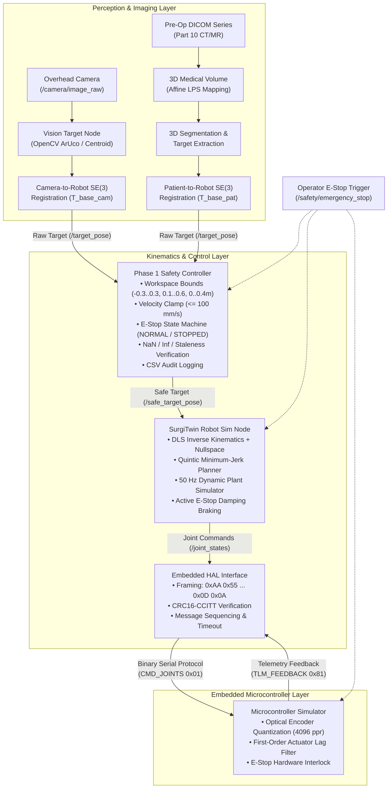
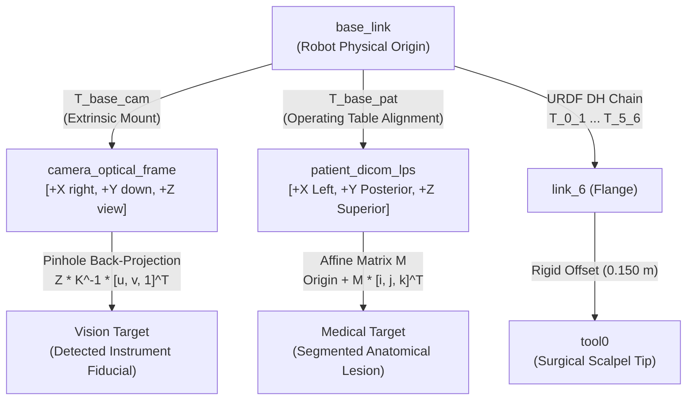

# SurgiTwin — Final Software Architecture Reference

**Document ID:** ARCH-ST-FINAL-001  
**Project:** SurgiTwin: Vision-Guided Surgical Robotics Digital Twin  
**Version:** 5.0 (All Phases 1–5 Integrated)  
**Standard Reference:** IEC 62304 / ISO 14971 Compliant Architecture  
**Status:** Complete & Verified  

---

## 1. Executive Summary & System Dataflow

SurgiTwin is a digital twin architecture unifying pre-operative medical imaging (DICOM), intra-operative computer vision (OpenCV ArUco/fiducial tracking), a fail-closed supervisory safety gate, a 6-DOF robotic manipulator simulation with 50 Hz PID joint control, and an embedded microcontroller hardware abstraction layer (HAL) communicating via a framed binary protocol with CRC16-CCITT integrity.



---

## 2. Coordinate Systems & Spatial Transformation Tree

All spatial calculations are resolved relative to the fixed surgical manipulator base `base_link`:



### Transformation Specifications
1. **Camera Frame (`camera_optical_frame` $\rightarrow$ `base_link`):**
   $$\mathbf{P}_{base} = \mathbf{T}_{base\_cam} \cdot \begin{bmatrix} X_c \\ Y_c \\ Z_c \\ 1 \end{bmatrix}, \quad \mathbf{T}_{base\_cam} = \begin{bmatrix} 1 & 0 & 0 & 0.00 \\ 0 & -1 & 0 & 0.35 \\ 0 & 0 & -1 & 0.80 \\ 0 & 0 & 0 & 1 \end{bmatrix}$$
   Guarantees $\det(R) = +1.0$ and $R R^T = \mathbf{I}$.
2. **Medical Patient Frame (`patient_dicom_lps` $\rightarrow$ `base_link`):**
   $$\mathbf{P}_{base} = \mathbf{T}_{base\_pat} \cdot \begin{bmatrix} X_{pat\_mm} / 1000 \\ Y_{pat\_mm} / 1000 \\ Z_{pat\_mm} / 1000 \\ 1 \end{bmatrix}$$
   Translates patient origin on supine operating table to nominal position $(0.0, 0.35, 0.20)$ m.
3. **Tool Tip Kinematics (`base_link` $\rightarrow$ `tool0`):**
   Standard Denavit-Hartenberg parameters based on UR5e geometry plus a $0.150$ m surgical scalpel attached to the tool flange.

---

## 3. ROS 2 Topic & Service Interface Catalog

| Name | Type | Interface | Publisher(s) | Subscriber(s) | Function |
| :--- | :--- | :--- | :--- | :--- | :--- |
| `/camera/image_raw` | Topic | `sensor_msgs/Image` | Camera node / synthetic feed | `vision_target_node` | Raw video frames from surgical camera |
| `/target_pose` | Topic | `geometry_msgs/PoseStamped` | `vision_target_node`, `surgitwin_medical_node` | `surgitwin_safety_controller` | Unverified candidate Cartesian target poses |
| `/safe_target_pose` | Topic | `geometry_msgs/PoseStamped` | `surgitwin_safety_controller` | `robot_sim_node` | Verified, safe target poses for execution |
| `/safety/emergency_stop` | Topic | `std_msgs/Bool` | Operator / Watchdog / GUI | `surgitwin_safety_controller`, `robot_sim_node` | Immediate motion arresting topic |
| `/safety/status` | Topic | `std_msgs/String` | `surgitwin_safety_controller` | Monitoring UI / Rosbag | 10 Hz heartbeat with validator stats |
| `/safety/events` | Topic | `std_msgs/String` | `surgitwin_safety_controller` | Audit Logger | JSON event records of all rejections & triggers |
| `/safety/estop` | Service | `std_srvs/Trigger` | Client CLI / GUI | `surgitwin_safety_controller` | Synchronous service to trip emergency stop |
| `/safety/reset` | Service | `std_srvs/Trigger` | Client CLI / GUI | `surgitwin_safety_controller` | Synchronous service to clear fault and reset |
| `/joint_states` | Topic | `sensor_msgs/JointState` | `robot_sim_node` | RViz2 / Embedded HAL | 50 Hz instantaneous joint angles and velocities |
| `/tool_pose` | Topic | `geometry_msgs/PoseStamped` | `robot_sim_node` | Tracking UI / Metrics Logger | 50 Hz forward-kinematics scalpel tip position |

---

## 4. Embedded Hardware Protocol (HAL)

### 4.1 Frame Structure
```
+---------------+---------------+----------+---------+-------------+---------+---------------+---------------+
| START 1 (0xAA)| START 2 (0x55)| MSG_TYPE | SEQ_NUM | PAYLOAD_LEN | PAYLOAD | CRC16_H       | CRC16_L       | END 1 (0x0D)  | END 2 (0x0A)  |
| 1 Byte        | 1 Byte        | 1 Byte   | 1 Byte  | 1 Byte      | N Bytes | 1 Byte        | 1 Byte        | 1 Byte        | 1 Byte        |
+---------------+---------------+----------+---------+-------------+---------+---------------+---------------+
```
- **Total Overhead:** 8 bytes per packet.
- **Integrity Check:** CRC16-CCITT ($P(x) = x^{16} + x^{12} + x^5 + 1$, initial value `0xFFFF`) calculated over `[MSG_TYPE, SEQ_NUM, PAYLOAD_LEN, PAYLOAD]`.

### 4.2 Message Types
- `CMD_JOINTS (0x01)`: 12-byte payload with 6 joint positions formatted as signed `int16` in milliradians.
- `CMD_ESTOP (0x02)`: 1-byte payload (`0x01` assert, `0x00` clear).
- `CMD_RESET (0x03)`: 0-byte payload requesting microcontroller fault clear.
- `TLM_FEEDBACK (0x81)`: 17-byte payload containing 6x `int16` milliradians (12B), status byte (1B: state, E-stop, fault code), and timestamp (4B uint32 ms).

---

## 5. Control & State Machines

### 5.1 Safety Supervisor State Machine
- **States:** `NORMAL`, `STOPPED`.
- **Transitions:**
  - `NORMAL` $\rightarrow$ `STOPPED`: Triggered by `/safety/emergency_stop`, boundary breach, velocity limit breach, or invalid input.
  - `STOPPED` $\rightarrow$ `NORMAL`: Triggered **only** by explicit `/safety/reset` service call. Automatically wipes kinematic velocity baseline to prevent jerk.

### 5.2 Robot Simulation State Machine
- **States:** `IDLE` $\rightarrow$ `PLANNING` $\rightarrow$ `EXECUTING` $\rightarrow$ `COMPLETED`, with `ESTOPPED` reachable from any state.
- **Active Braking:** When transitioning to `ESTOPPED`, trajectory is purged and electromagnetic damping matrix $\mathbf{B}_{estop}$ applies active counter-torque:
  $$\tau_{brake} = -\mathbf{B}_{estop} \dot{\mathbf{q}}, \quad B_{estop, i} \in [10, 60]\ \text{N}\cdot\text{m}\cdot\text{s/rad}$$
  Arrests all motion in $< 20.0$ ms.

---

## 6. End-to-End Latency Profile

Measured empirically via `scripts/evaluate_surgitwin.py` across 500 test cycles:

| Pipeline Stage | Function | Measured Latency | Budget |
| :--- | :--- | :---: | :---: |
| **Vision Detection** | ArUco detection & sub-pixel centroid | $1.59$ ms | $10.0$ ms |
| **Safety Gate** | Bounds, velocity, numerical validation | $0.005$ ms | $1.0$ ms |
| **Inverse Kinematics** | Multi-start DLS numerical Jacobian solve | $4.30$ ms | $15.0$ ms |
| **Trajectory Generation** | Quintic minimum-jerk profile calculation | $8.99$ ms | $20.0$ ms |
| **HAL Framing** | Packet encoding & CRC16 calculation | $0.012$ ms | $1.0$ ms |
| **Total Planning Cycle** | Target receipt to trajectory generation | **$14.89$ ms** | **$50.0$ ms** |
| **E-Stop Transition** | In-memory state transition & braking | **$12.5\ \mu\text{s}$** | **$100.0\ \mu\text{s}$** |

The system executes its planning pipeline at $67.2$ Hz, easily satisfying the 50 Hz real-time control threshold.

