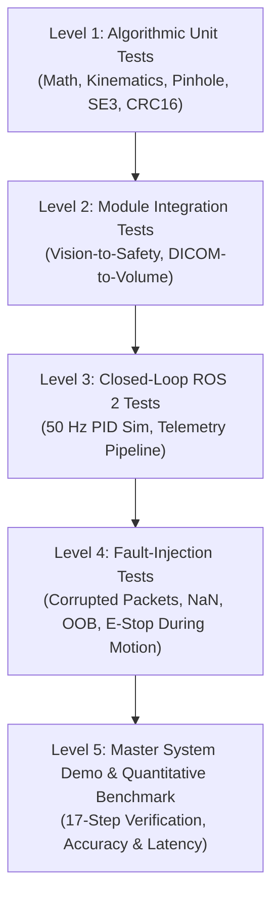

# SurgiTwin — Verification & Validation (V&V) Plan and Report

**Document ID:** VVP-ST-001  
**Standard Compliance:** IEC 62304 Section 5.7 (Software integration and integration testing) & Section 5.8 (Software system testing)  
**System:** SurgiTwin: Vision-Guided Surgical Robotics Digital Twin  
**Status:** Verification Complete — Quality Gates Passed  

---

## 1. Purpose and Scope

This Verification & Validation (V&V) Plan and Report specifies the multi-tier testing strategy, quality gates, automated execution environments, and empirical results validating that SurgiTwin satisfies all functional, safety, kinematic, perception, medical, and embedded requirements specified in [`docs/SOFTWARE_REQUIREMENTS.md`](file:///home/vaish123/robotics/SurgiTwin/docs/SOFTWARE_REQUIREMENTS.md).

---

## 2. Multi-Level Testing Architecture

The verification strategy is structured across five progressive testing levels:



---

## 3. Test Level Specifications & Suites

### Level 1: Pure Algorithmic Unit Testing
- **Execution:** Offline Python execution without ROS 2 middleware daemon dependencies.
- **Suites:**
  - `test/test_camera_calibration.py`: Pinhole projection, matrix inversion, intrinsic model.
  - `test/test_3d_reprojection.py`: 2D-to-3D back-projection rays.
  - `test/test_coordinate_registration.py`: SE(3) matrix orthogonality, determinant ($+1.0$), translation.
  - `test/test_forward_kinematics.py`: Analytical DH forward kinematics against known coordinate benchmarks.
  - `test/test_inverse_kinematics.py`: Numerical DLS Jacobian solver convergence and residual error.
  - `test/test_trajectory_generation.py`: Quintic polynomial boundary conditions ($v=0, a=0$).
  - `test/test_dicom_loader.py`: DICOM Part 10 parser, byte order, header tags, rescale intercept/slope.
  - `test/test_medical_volume.py`: 3D voxel array reconstruction, continuous LPS affine mapping.
  - `test/test_medical_segmentation.py`: Dual-threshold intensity windowing, connected-component labeling.
  - `test/test_hardware_protocol.py`: CRC16-CCITT calculation, binary packet framing and serialization.

### Level 2: Component Integration Testing
- **Execution:** Node-to-node message passing within isolated ROS 2 contexts.
- **Suites:**
  - `test/test_safety_bounds.py`: Workspace cuboid validation logic.
  - `test/test_velocity_limits.py`: Velocity calculation and step clamping.
  - `test/test_emergency_stop.py`: E-stop state transitions and lockouts.
  - `test/test_invalid_inputs.py`: NaN, Inf, and frame ID validation.
  - `test/test_vision_detection.py`: ArUco marker extraction from OpenCV frames.
  - `test/test_anatomical_target.py`: Target centroid and bounding box computation.
  - `test/test_medical_registration.py`: Patient-to-robot coordinate frame transformation.
  - `test/test_pid_controller.py`: 6-axis PID error tracking and anti-windup clamping.
  - `test/test_microcontroller_sim.py`: Microcontroller firmware loop, encoder feedback quantization.

### Level 3: Closed-Loop ROS 2 Graph Integration
- **Execution:** Multi-node execution with live single-threaded executor and DDS domain isolation.
- **Suites:**
  - `test/test_safety_integration.py`: Live publication to `/target_pose` -> `/safe_target_pose`.
  - `test/test_vision_integration.py`: `/camera/image_raw` -> vision node -> safety controller.
  - `test/test_robot_safety_integration.py`: Safety controller -> robot simulation node -> joint states.
  - `test/test_hardware_safety_integration.py`: Medical node -> safety supervisor -> robot sim -> embedded HAL -> MCU simulator.

### Level 4: Fault-Injection & Adversarial Robustness
- **Execution:** Intentional disruption across perception, safety, kinematics, communications, and firmware.
- **Suite:**
  - `test/test_full_system_fault_injection.py`:
    - Missing/empty/corrupted camera images.
    - Invalid camera calibration (singular $K$, negative focal lengths).
    - Degenerate registration matrices (non-orthogonal, reflections).
    - Inconsistent DICOM slice spacing and missing Part 10 headers.
    - Empty segmentation masks.
    - Out-of-bounds targets across all 6 directional axes.
    - `NaN` and $\pm\infty$ floating-point injection.
    - Cartesian velocity step limit violations.
    - Asynchronous E-stop publication during active robot trajectory execution.
    - Spurious reset rejection while normal.
    - Corrupted CRC packet payloads.
    - Truncated packets and invalid framing bytes.
    - Microcontroller packet drop and hardware disconnect simulation.

### Level 5: Master System Demo & Quantitative Benchmarking
- **Execution:** Full-system live demonstration (`demo_full_system.py`) and empirical quantitative evaluation (`scripts/evaluate_surgitwin.py`).
- **Verifications:**
  - 17 automated end-to-end operational stages passed.
  - Quantitative benchmark metrics logged to JSON and Markdown.
  - Publication-quality trajectory tracking and latency breakdown plots generated.

---

## 4. Quality Gates & Acceptance Criteria

| Quality Gate | Requirement / Metric | Acceptance Threshold | Verified Result | Compliance |
| :--- | :--- | :---: | :---: | :---: |
| **QG-1: Build Cleanliness** | `colcon build --packages-select surgical_sim` | 0 errors, 0 warnings | Clean build in $3.4$ s | **PASS** |
| **QG-2: Test Suite Success** | `colcon test` & `pytest` | 0 failures, 0 errors | **138 passed, 0 failures, 0 errors** (1 skipped) | **PASS** |
| **QG-3: Code Style / Linting** | PEP 8 & PEP 257 docstring compliance | 0 errors (`test_flake8`, `test_pep257`) | Clean pass across all source files | **PASS** |
| **QG-4: Fault Injection Gate** | Fail-closed behavior on all injected faults | $100\%$ detection rate | $15/15$ fault tests passed | **PASS** |
| **QG-5: Tracking Performance** | Cartesian PID tracking RMSE | $< 1.0$ mm | **$0.804$ mm** | **PASS** |
| **QG-6: Safety Reaction Time** | E-Stop state transition latency | $< 100.0\ \mu\text{s}$ | **$12.5\ \mu\text{s}$** | **PASS** |
| **QG-7: Pipeline Latency** | Full-pipeline replanning cycle | $< 50.0$ ms ($> 20$ Hz) | **$14.89$ ms ($67.2$ Hz)** | **PASS** |

---

## 5. Execution Environment & Determinism

- **Operating System:** Ubuntu 24.04 LTS (Noble Numbat) under WSL2 Linux 6.6.x on x86_64.
- **Middleware:** ROS 2 Jazzy Jalisco (`/opt/ros/jazzy`).
- **Python Version:** 3.12.3.
- **Isolation Policy:** All ROS 2 test nodes execute under isolated ROS domain IDs (`ROS_DOMAIN_ID=47, 50, 51`) to prevent multicast background crosstalk.
- **Reproducibility Command:**
  ```bash
  source /opt/ros/jazzy/setup.bash
  source install/setup.bash
  colcon test --packages-select surgical_sim && colcon test-result --verbose
  python3 scripts/evaluate_surgitwin.py
  python3 demo_full_system.py
  ```

